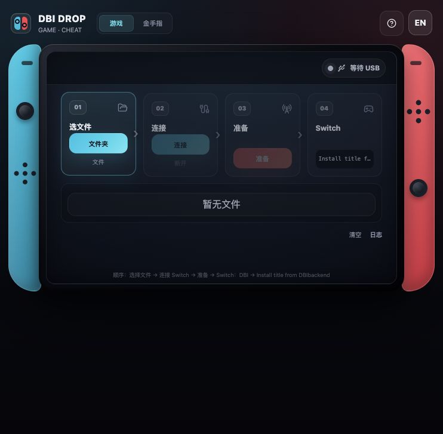

# SwitchDBIbackendMac · DBI Drop

[](https://joefirmament.github.io/SwitchDBIbackendMac/)
[](LICENSE)

一个为 macOS 与 Switch 玩家设计的纯网页工具，用于通过 DBI Backend 安装游戏内容，并整理、写入 Atmosphère 金手指。

## 在线使用

**访问地址：<https://joefirmament.github.io/SwitchDBIbackendMac/>**

推荐使用最新版 Chrome 或 Edge。页面在浏览器本地处理文件，不会把游戏文件或金手指上传到服务器。



## 用途

### 游戏安装

通过 WebUSB 与 Switch 上的 DBI Backend 通信，提供 NSP、XCI、NSZ、XCZ 文件。玩家可以把本体、更新包和 DLC 一次加入列表，再回到 DBI 中依次或批量选择安装。

### 金手指安装

读取 ZIP 或解压后的金手指文件夹，自动识别以下 Atmosphère 目录结构：

```text
<Title ID>/cheats/<Build ID>.txt
```

识别完成后，工具会将文件写入 SD 卡：

```text
atmosphere/contents/<Title ID>/cheats/<Build ID>.txt
```

若目标位置已有同名文件，旧文件会先备份至：

```text
DBI-Drop-Backups/cheats/
```

## 便捷在哪里

- 无需安装 DBIbackend 桌面程序，打开网页即可使用。
- 可以直接选择整个游戏文件夹，不必逐个添加安装包。
- 自动区分本体、更新包、DLC 与整合包，识别不准时也可以手动修正。
- USB 只需连接和准备一次，随后可在 Switch 的 DBI 中继续选择多个文件。
- 使用拟物 Switch 界面集中显示等待连接、连接成功、准备完成、传输中和传输完成等状态。
- 金手指支持 ZIP 和文件夹，不需要手动逐层创建 Title ID、`cheats` 和 Build ID 路径。
- 覆盖金手指前自动备份已有文件，方便恢复。
- 游戏与金手指文件均在本机处理，不经过云端上传。

## 使用方法

### 安装游戏本体、更新包或 DLC

准备条件：

- Switch 已安装并能够运行 [DBI](https://github.com/rashevskyv/dbi)。
- 使用支持数据传输的 USB-C 数据线。
- 电脑使用 Chrome 或 Edge，并通过 HTTPS 页面访问本工具。

操作步骤：

1. 在网页顶部选择“游戏”。
2. 选择包含本体、更新包和 DLC 的文件夹，也可以单独选择多个文件。
3. 在 Switch 上打开 DBI 的 Backend 模式，并通过 USB 连接电脑。
4. 点击网页中的“连接”，在浏览器设备窗口中选择 Switch。
5. 点击“准备”。
6. 回到 Switch，进入 `Install title from DBIbackend`。
7. 在 DBI 列表中选择需要安装的本体、更新包和 DLC。

DBI Backend 与 DBI 的 MTP 模式不是同一种连接方式。使用本网页安装游戏时，应进入 Backend 模式。

### 安装金手指

网页不能直接把 DBI 的 MTP 设备当作普通文件夹写入，因此需要先把 SD 卡挂载成电脑可访问的磁盘。

1. 使用读卡器连接 SD 卡；或者进入 Hekate，选择 `Tools → USB Tools → SD Card`。
2. 确认 SD 卡已经出现在 macOS 或电脑的磁盘列表中。
3. 在网页顶部选择“金手指”。
4. 点击“选择 SD 卡”，选择包含 `atmosphere` 文件夹的 SD 卡根目录。
5. 选择金手指 ZIP 或已解压的文件夹。
6. 确认识别到的 Title ID 和文件数量后，点击“写入 SD 卡”。
7. 安全弹出 SD 卡，然后回到 Switch。

## 浏览器与系统说明

- macOS：推荐 Chrome 或 Edge；Safari 不支持本工具所需的全部 WebUSB 与目录写入功能。
- Linux：Chrome 或 Chromium 通常可用，部分系统可能需要 USB 设备权限规则。
- Windows：WebUSB 模式可能需要 WinUSB 驱动；如果只使用 DBI MTP，可继续使用系统文件管理器，不必使用本网页的游戏模式。
- 直接双击 `index.html` 打开的 `file://` 页面不能完整使用 WebUSB。请使用 GitHub Pages、HTTPS 或 `localhost`。

## 本地运行

仓库是纯静态页面，不需要构建：

```bash
python3 -m http.server 8080
```

然后访问：<http://localhost:8080/>

## 项目地址

- 在线页面：<https://joefirmament.github.io/SwitchDBIbackendMac/>
- GitHub 仓库：<https://github.com/JoeFirmament/SwitchDBIbackendMac>

## 致谢与来源

本项目是在以下开源项目基础上进行二次开发与重新设计：

- [FallingMY/ns-web-dbibackend](https://github.com/FallingMY/ns-web-dbibackend)：提供浏览器通过 WebUSB 与 DBI Backend 通信的原始实现基础。
- [rashevskyv/DBI](https://github.com/rashevskyv/dbi)：Switch 端 DBI 工具及 Backend 工作方式。
- [Atmosphere-NX/Atmosphere](https://github.com/Atmosphere-NX/Atmosphere)：Atmosphère 金手指目录与运行环境。
- [CTCaer/hekate](https://github.com/CTCaer/hekate)：可通过 USB Tools 将 SD 卡挂载到电脑。

感谢以上项目及其维护者。上游代码版权与署名按仓库中的 [MIT License](LICENSE) 保留。

## 免责声明

本项目不包含、提供或分发任何游戏、更新包、DLC 或金手指内容。请仅处理你有权使用的文件，并自行承担修改主机与 SD 卡内容的风险。本项目与 Nintendo、DBI、Atmosphère 和 Hekate 的维护团队没有隶属关系。

## 许可证

本项目依照 [MIT License](LICENSE) 发布。
